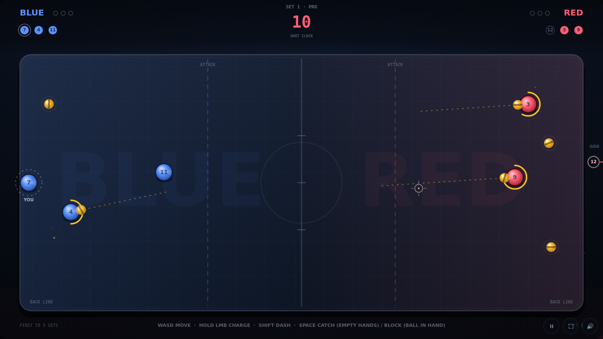

# Dodgeball Simulator

A 3-on-3 browser dodgeball game built around the **Dodgeball Victoria / WDBF Foam
Playing Format** rules: opening rush, attack-line ball activation, catches that
bring a teammate back in, live-ball blocking, and a ten-second advantage clock.

**[▶ Play it in your browser](https://waynevanson.github.io/dodgeball-simulator/)**



- 3v3 with AI teammates and opponents, three difficulty levels
- Mouse + keyboard on desktop, on-screen stick + buttons on phones
- Canvas rendering, WebAudio sound effects, zero external assets
- Vite + strict TypeScript, UI styled with CSS Modules
- Match/round flow modelled with an **XState v5** statechart

---

## How to play

### Desktop

| Input | Action |
| --- | --- |
| `W` `A` `S` `D` / arrows | Move |
| Mouse | Aim |
| Hold **LMB** | Charge a throw, release to fire |
| `Shift` | Dash |
| `Space` / **RMB** | Catch (empty hands) / block (ball in hand) |
| `Esc` / `P` | Pause |
| `M` | Mute |

### Mobile

Rotate the phone to landscape, then:

- **Left stick** – move
- **THROW** – hold to charge, release to throw (auto-aims at the nearest opponent)
- **DASH** – dash in the stick direction
- **CATCH** – catch or block
- **Pause / fullscreen / sound** – top-right

### The set in one paragraph

Both teams line up on their back line. On the whistle, sprint to the centre line
and grab one of your three balls. A ball picked up in the rush is **inactive**
until you carry it behind your 3 m attack line. Hit an opponent with a live,
armed ball to eliminate them. Catch a live ball and the thrower is out **and**
your first queued teammate re-enters over the back line. Holding a ball lets you
block instead of catch. The team with the ball advantage has ten seconds to
throw or it forfeits every ball it holds. First to 3 sets wins.

---

## Rules implementation

The game follows the [Dodgeball Victoria rules](https://www.dodgeballvictoria.com.au/rules)
(WDBF Official Rules, Victorian adjustments). Rules that describe the actual
sport rather than administration are implemented:

| Rule | Implemented behaviour |
| --- | --- |
| **1.1 / 1.3.4** | 18 × 9 m court mapped to the canvas; attack lines exactly 3 m from the centre line |
| **2.1(2) / 12.1(2)** | Six balls, three per team, placed on the centre line 1.5 m apart |
| **13.1–13.6** | Opening rush: everyone starts on the back line, may touch/cross the centre line only during the rush, and may only take their own three balls |
| **13.7** | A rushed ball must fully cross the attack line to become live; throwing it early cannot eliminate anyone, but it can still be caught |
| **15.6** | A live ball dies the moment it touches a surface (walls count) — no wall bounces |
| **16.1 / 16.3** | An attempt is valid if it passes within 1 m of an opponent or of where they stood at release; clear misses are logged as warnings rather than automatic outs |
| **17.3** | Ball advantage + 10-second shot clock with an audible countdown; at zero the offending team forfeits every held ball and both teams line up |
| **19** | Any hit from a live, armed ball eliminates the player |
| **21.2 / 22** | A ball in hand blocks: the incoming ball deflects and **remains live**; the blocker keeps their ball (disarming simplified) |
| **23.1 / 23.4 / 25** | Catches eliminate the thrower; the catching team's first queued player re-enters over the back line with an entering grace period (cannot be hit or make plays) |
| **23.6** | A caught ball is dead and belongs to the catcher |
| **26.5** | Players are confined to their own half — crossing the centre line is impossible |
| **29.3(2)** | Simultaneous all-out voids the set: no point is awarded and the set is replayed |
| **9.7.1 / 10.2** | Sets are won by eliminating the opposition (1 point); first to 3 sets wins the match; after two minutes of set time **sudden death** disables blocking |
| **20 / 24** | Out players leave the court and wait in a visible queue behind the back line |

### Deliberate simplifications

These are documented rather than hidden:

- **Match length.** VDL matches are two 20-minute halves of timed sets. A browser
  game uses “first to 3 sets”, with each set ending only when a team is fully
  eliminated (foam format), plus sudden death at 2 minutes of set time.
- **Team size.** 3v3 instead of 6v6 so a whole court fits on one screen.
- **Administration.** Uniforms, cards, referees, timeouts, substitutions, ball
  retrievers and rule challenges are out of scope. Invalid throws are tracked as
  warnings, matching the referee's discretion in Rule 16.3.
- **Boundaries.** Rather than calling players out for touching a line, the court
  geometry keeps everyone inside their own half.
- **Disarming (Rule 22).** A successful block keeps the blocking ball under
  control instead of modelling the drop-and-regain sequence.

Missed attempts, catching, blocking, the shot clock and the queue are all visible
in the HUD so the state of the set is always readable.

---

## Architecture

The behaviour is modelled as an XState chart; the physics simulation knows
nothing about scores, menus or match flow.

```
                 ┌─────────────────┐
   START         ▼                 │
  menu ─▶ active.running.countdown ──3.1s──▶ playing
                          ▲                    │
                          │      SET_OVER      │ hit / catch / all-out
                          │                    ▼
                          └────3s──── setOver ──▶ matchOver
                active.paused ──RESUME (deep history)──▶ back to where you were
```

```
src/
├── main.ts                     # boot, rAF loop, phase-change effects
├── machine/gameMachine.ts      # XState chart: menu / countdown / playing / setOver / matchOver / paused
├── game/
│   ├── world.ts                # simulation + the VDL rule engine (hits, catches, shot clock, queues)
│   ├── entities.ts             # Player and Ball state machines-in-miniature
│   ├── ai.ts                   # teammates + opponents (rushing, arming, kiting, dodging, catching)
│   ├── renderer.ts             # canvas rendering, HUD, banners
│   ├── input.ts                # keyboard, mouse and touch (virtual stick + buttons)
│   ├── audio.ts                # WebAudio synth (no audio files)
│   ├── constants.ts            # court dimensions, physics, difficulty, rules constants
│   ├── types.ts                # shared types, including the HUD view model
│   └── math.ts                 # small helpers
├── ui/
│   ├── shell.ts                # menu/pause/results/rules screens + top controls
│   └── shell.module.css        # CSS Modules for the UI shell
└── styles/global.css           # page, canvas and touch layout
```

`GameWorld` reports `SET_OVER` events; the chart owns the score and decides what
happens next. `main.ts` subscribes to phase changes and runs the side effects
(reset the world, show a screen, play a whistle), which keeps the chart
declarative and the simulation free of UI concerns.

---

## Development

Requires **Node 20+** and **pnpm 10** (pinned via `packageManager`).

```bash
pnpm install
pnpm dev        # http://localhost:5173
pnpm typecheck  # tsc --noEmit
pnpm build      # typecheck + Vite production build into dist/
pnpm preview    # serve the production build
```

Vite uses a relative `base`, so the build works at any path (including
`https://<user>.github.io/dodgeball-simulator/`).

---

## Deployment

`.github/workflows/deploy.yml` installs with pnpm, runs the typecheck/build and
publishes `dist/` to GitHub Pages on every push to `main`.

One-time setup: **Settings → Pages → Build and deployment → Source: GitHub
Actions**. No branch or folder needs to be configured.

---

## Credits

Rules based on the World Dodgeball Federation Official Rules as published by
[Dodgeball Victoria](https://www.dodgeballvictoria.com.au/rules). This is an
unofficial fan project and is not affiliated with Dodgeball Victoria or the WDBF.
